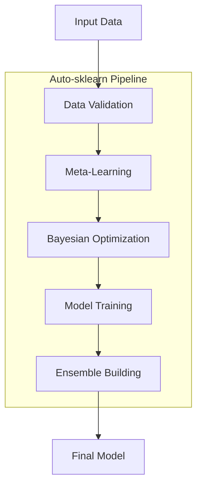

# Auto-sklearn Documentation

Welcome to the official documentation for **Auto-sklearn**, an automated machine learning toolkit built on top of scikit-learn.

## What is Auto-sklearn?

Auto-sklearn is an automated machine learning (AutoML) toolkit that frees machine learning users from algorithm selection and hyperparameter tuning. It leverages recent advances in Bayesian optimization, meta-learning and ensemble construction to automatically select, configure and combine machine learning models.

## Key Features

- **Automated Algorithm Selection**: Automatically selects the best machine learning algorithm for your data
- **Hyperparameter Optimization**: Uses Bayesian optimization to find optimal hyperparameters
- **Ensemble Construction**: Builds powerful ensembles from the best models found
- **Meta-Learning**: Uses knowledge from previous datasets to bootstrap the search
- **Easy to Use**: Simple scikit-learn compatible API

## Quick Start

```python
import autosklearn.classification
from sklearn.datasets import load_iris
from sklearn.model_selection import train_test_split

# Load data
X, y = load_iris(return_X_y=True)
X_train, X_test, y_train, y_test = train_test_split(X, y, random_state=42)

# Create and fit Auto-sklearn classifier
automl = autosklearn.classification.AutoSklearnClassifier(
    time_left_for_this_task=60,
    per_run_time_limit=10,
)
automl.fit(X_train, y_train)

# Predict
predictions = automl.predict(X_test)
print(f"Accuracy: {automl.score(X_test, y_test):.4f}")
```

## Architecture Overview



## Supported Tasks

| Task | Description |
|------|-------------|
| Classification | Binary and multi-class classification |
| Regression | Single and multi-output regression |
| Multi-label | Multi-label classification |

## Next Steps

- [Installation Guide](installation.md) - Get started with installation
- [Quick Start](quickstart.md) - Learn the basics
- [Examples](examples/index.md) - Explore practical examples
- [API Reference](api/index.md) - Dive into the API
- [Extending](extending.md) - Add custom components
